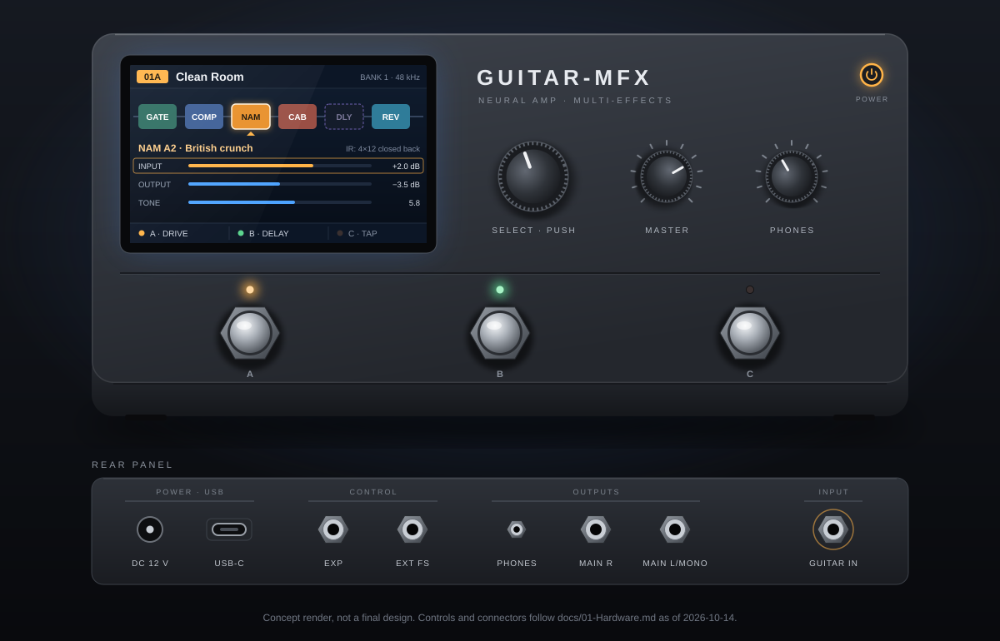
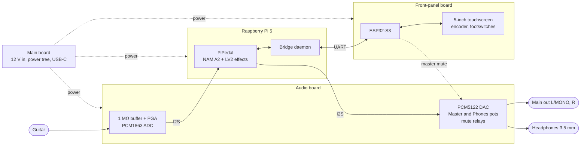

# Guitar-MFX

<p align="center">
  
</p>

**A DIY multi-effects floor unit for electric guitar.** A Raspberry Pi 5 runs PiPedal and Neural Amp Modeler (NAM A2) captures of real amplifiers. Custom boards provide a low-noise guitar input and the line and headphone outputs. An ESP32-S3 drives a 5-inch touchscreen and the footswitches.

> **Status, 2026-10-14: design phase.** No Guitar-MFX hardware has been built or measured yet. The image above is a concept, not a final design. Figures below are targets or vendor specifications; measured results appear only in [03-Measurements.md](docs/03-Measurements.md).

## Goals

- **Tone first:** captured real amplifiers (NAM A2), cabinet IRs, and conventional effects, played through a quiet, high-impedance input.
- **Low, stable latency:** proposed target of 3 ms analog round trip, with 5 ms as the gate for the first playable prototype.
- **Learning:** embedded Linux, mixed-signal PCB design, and MCU user interfaces, built by one player for one guitar in a quiet room.

## Planned features

| Area | Plan |
|---|---|
| Tone engine | PiPedal 2.x with LV2 effects and native NAM A2, at a fixed 48 kHz |
| Guitar input | 1 MΩ FET-input buffer, software-set PGA, TI PCM1863 ADC |
| Outputs | Main out L/MONO and R (6.35 mm, line level) with an analog Master knob; 3.5 mm headphones with their own Phones knob |
| Safety | Relays keep every output muted until audio is stable, and during shutdown |
| Guitar amplifier | Feed it from the main outputs with the cabinet IR switched off |
| Control | 5.0-inch 800×480 IPS touchscreen, push encoder, three footswitches (proposed), external footswitch and expression jacks |
| Computer | USB-C audio for recording; native Pi 5 gadget or a bridge chip, chosen after the Phase 3 tests |
| Power | 12 V DC adapter; soft power button with orderly shutdown; pulling the plug mutes the outputs and leaves the system intact |

## How it works



The Pi 5 owns all real-time audio. The ESP32-S3 owns the display, controls, and mute supervision, and talks to the Pi only through a bridge daemon over UART; audio never passes through it.

## Hardware: three custom boards

| Board | Carries | Built after |
|---|---|---|
| Audio board | Guitar input, PGA, PCM1863 + PCM5122 codec, output stages, Master and Phones pots, mute relays | Phase 0 audio measurements |
| Main board | 12 V input, power tree for the Pi 5 and the other boards, panel USB-C, external footswitch and expression jacks | Phase 3 USB and power proof |
| Front-panel board | ESP32-S3-WROOM-1-N16R8, display and touch connectors, backlight driver, I/O expander, encoder, power button | Display gate |

The audio and main boards sit beside the Pi 5 on a ribbon from its 40-pin header, which keeps the analog section away from the Pi's switching regulators. Until the audio board exists, a HiFiBerry DAC2 ADC Pro, which uses the same PCM1863 and PCM5122 pair, is the bench reference. Details: [01-Hardware.md](docs/01-Hardware.md).

## Roadmap

Each phase ends with a measured gate defined in [02-Architecture.md](docs/02-Architecture.md) §10.

0. **Audio feasibility:** Pi 5, HiFiBerry DAC2 ADC Pro, and a prototype input buffer; latency, noise, and stability.
1. **Complete audio engine:** NAM A2, effects, presets, and real-time tuning.
2. **ESP32-S3 control surface:** display gate at 23 MHz or more, bridge daemon, and controls.
3. **USB and header power:** prove the USB audio path and powering the Pi 5 through its header.
4. **Guitar-MFX boards:** design and bring-up of the three boards.
5. **Final assembly:** enclosure, cooling, and full regression tests.
6. **Optional hybrid accelerator:** only if Linux misses the latency gate.

## Documentation

| Document | Contents |
|---|---|
| [00-UserRequirement.md](docs/00-UserRequirement.md) | Goals, requirements, proposed targets, open questions |
| [01-Hardware.md](docs/01-Hardware.md) | Hardware selections, the three boards, power, purchase list |
| [02-Architecture.md](docs/02-Architecture.md) | System architecture, safety states, phases, gates, risks |
| [03-Measurements.md](docs/03-Measurements.md) | The only record of measured results, failures included |
| [90-DecisionRecord.md](docs/90-DecisionRecord.md) | Why each decision was made, with sources |
| [references/README.md](docs/references/README.md) | Vendor datasheets |
| [hardware/README.md](hardware/README.md) | EasyEDA sources and fabrication files per board |

## Repository layout

```text
docs/              requirements, hardware, architecture, measurements, decisions
docs/images/       concept art and diagrams
docs/references/   vendor datasheets
hardware/          EasyEDA sources and fabrication outputs, one folder per board
```

## Built on

[PiPedal](https://rerdavies.github.io/pipedal/) · [Neural Amp Modeler](https://github.com/sdatkinson/NeuralAmpModelerCore) · [LVGL](https://lvgl.io)
